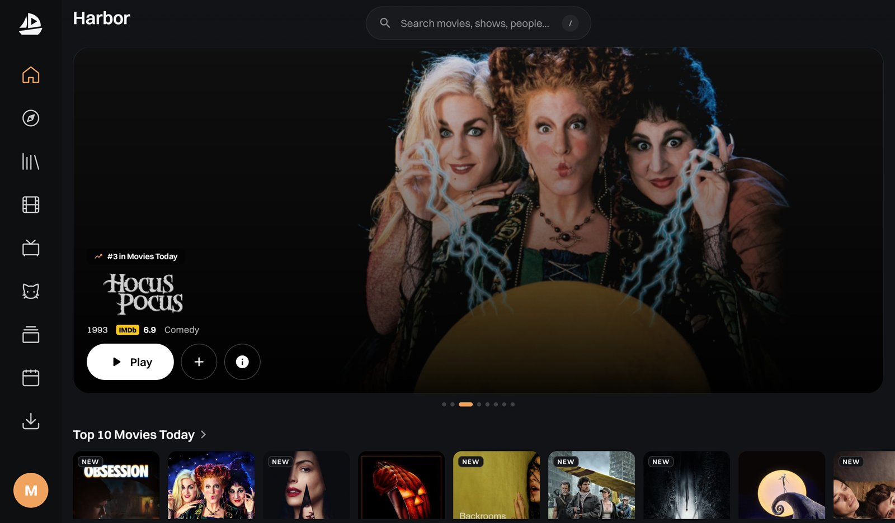
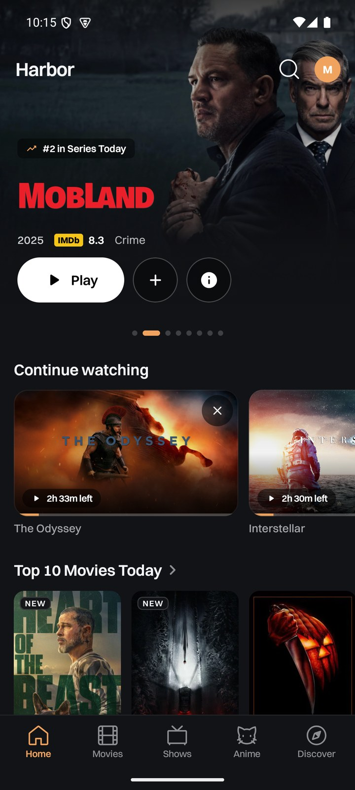
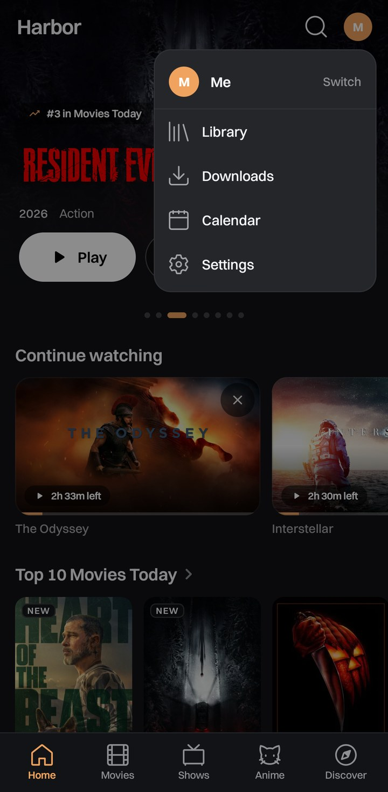
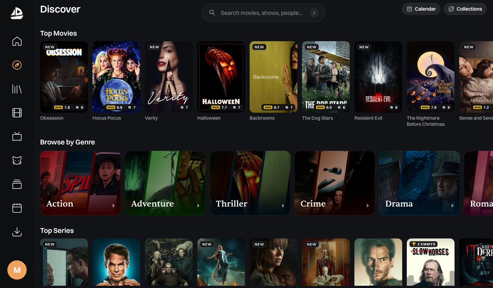
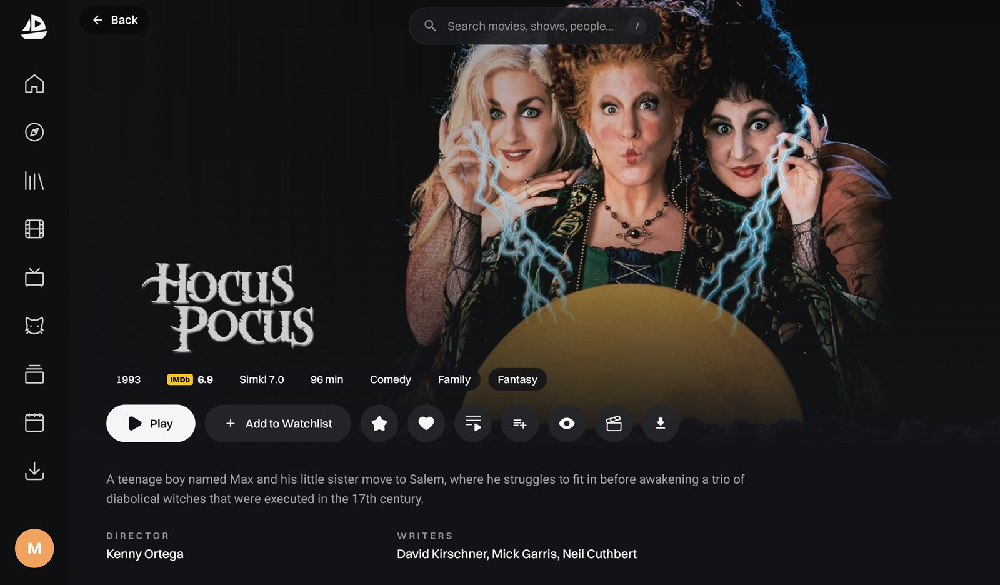
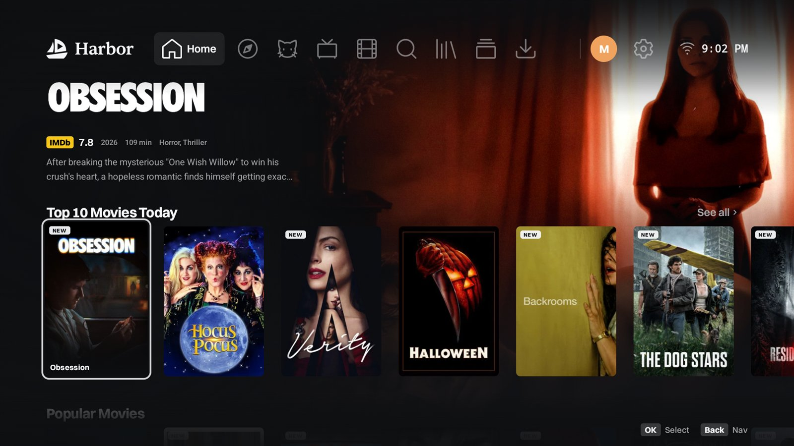
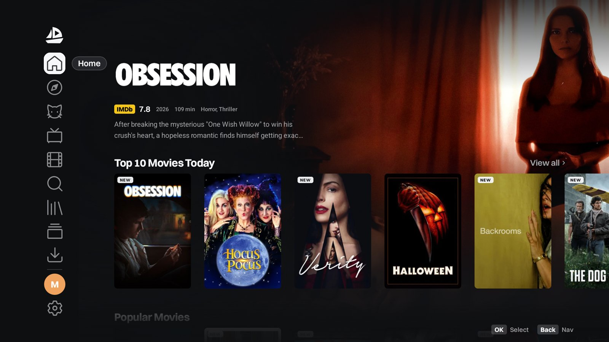

<div align="center">
<a name="readme-top"></a>

<picture>
  <source media="(prefers-color-scheme: dark)" srcset="/docs/media/harbor-wordmark-dark.svg">
  <source media="(prefers-color-scheme: light)" srcset="/docs/media/harbor-wordmark-light.svg">
  
</picture>

### Harbor for Android: A Stremio Client Built for Adventure, on Your Phone, Tablet and TV!

A native Android app with Harbor's look, a native player, Harbor's stream ranking engine, subtitles from many sources, profiles, and a Big Picture layout made for the remote.

<br/>

[![Version][badge-version]][releases] &nbsp;
[![License][badge-license]][license] &nbsp;
[![Kotlin][badge-kotlin]][kotlin] &nbsp;
[![Jetpack Compose][badge-compose]][compose] &nbsp;
[![Rust core][badge-rust]][rust] &nbsp;
[![Platforms][badge-platforms]][releases]

<br/>

[Why Harbor for Android](#why-harbor-for-android) &middot; [Screenshots](#screenshots) &middot; [Features](#feature-tour) &middot; [Install](#install) &middot; [Configuration](#configuration) &middot; [Build from source](#build-from-source) &middot; [FAQ](#faq) &middot; [License](#license)

</div>

<p align="center">
  
  <br/>
  <sub>Harbor on a tablet: a rotating hero, Top 10, and full width rails. Works on Cinemeta out of the box; richer with a free TMDB key.</sub>
</p>

> [!IMPORTANT]
> Harbor is a media player and a client for the open Stremio addon protocol. It hosts, indexes, and ships no media, and it bundles no content addons. Use it with your own media and sources you are authorized to access. See the [Disclaimer](#disclaimer).
> Harbor for Android is a free, not-for-profit fork of [Harbor](https://github.com/Harborofficial/Harbor), the desktop app. Found a bug or have an idea? Please [open an issue][issues] so it can be fixed for everyone.

ATTENTION: HARBOR DOES NOT AND WILL NOT ASK YOU FOR DONATIONS! If someone claims to be us and asks you for donations, IT IS NOT US. Want to donate to a good cause? Consider the National Pediatric Cancer Foundation (https://nationalpcf.org/), Electronic Frontier Foundation (https://www.eff.org/), or St. Jude's (https://www.stjude.org/). You can also find a charity at https://www.charitynavigator.org/.
<br/>
<br/>
HARBOR IS AN OPEN CONCEPT AND NOT AN ENTITY. WE DO NOT PROFIT OR ACCEPT MONEY FOR IT. WE DO NOT PROVIDE ANY CONTENT OR TELL YOU HOW TO DO IT. IT IS JUST CODE ON A REPO. ITS CONTRIBUTORS ARE NOT RESPONSIBLE FOR WHAT YOU DO WITH IT OR WHAT STREMIO ADDONS AND SOURCES YOU ALREADY HAVE. FOLLOW ALL LAWS OF YOUR JURISDICTION.
<br/>
<br/>

<details>
<summary><kbd>Table of contents</kbd></summary>

<br/>

- [Why Harbor for Android](#why-harbor-for-android)
- [Screenshots](#screenshots)
- [Feature Tour](#feature-tour)
- [Privacy](#privacy)
- [Install](#install)
- [Configuration](#configuration)
- [Build from source](#build-from-source)
- [FAQ](#faq)
- [Contributing](#contributing)
- [Disclaimer](#disclaimer)
- [Acknowledgements](#acknowledgements)
- [License](#license)

</details>

<br/>

## Why Harbor for Android

**Harbor for Android** brings Harbor to phones, tablets, and Android TV as a native app, not a web view. Out of the box it runs on Cinemeta. Add a free TMDB key and it grows into a full companion for finding and watching what you love.

- **One app, three layouts.** On phones, a full-width banner with Home, Movies, Shows, Anime, and Discover as labelled tabs at the bottom, and Search and your profile at the top; on tablets, a side rail; on Android TV, Harbor's Big Picture layout with the menu across the top or down the left side, driven entirely by the remote.
- **People and awards.** Tap anyone in the cast or crew for their photo, biography, awards, and filmography. Every award (Oscars, Emmys, Golden Globes, BAFTA, Cannes and more) has its own page of winners and nominees by year.
- **A native player.** mpv on phones and tablets, with shaders, Anime4K upscaling, subtitle styling, and live subtitle sync. Android TV plays through Media3 and the TV's own hardware decoders, so streams start reliably even on modest TVs.
- **Harbor's stream ranking.** The same Rust core as Harbor on the desktop parses every stream, filters out fakes, and ranks the best sources first, with "Cached on" labels for your debrid service.
- **Subtitles done right.** Subtitles from your addons and from OpenSubtitles, SubDL, SubSource, and Wyzie, named the way Harbor PC names them and filtered to your languages.
- **Posters that tell you more.** Award pills (Oscar, Emmys, Saturns and more), NEW and IN CINEMA tags, and IMDb and Simkl scores on every poster.
- **Profiles for the whole house.** Several profiles, each with its own library, progress, and settings, plus your Harbor account picture.
- **Sync what you already use.** Sign in to Stremio for your addons and library, and connect Trakt or Simkl to keep your history in step.
- **Send to a TV.** Set up Harbor on a TV from your phone: sign-ins, settings, lists, and progress go straight over your home network.
- **Speaks your language.** Harbor PC's 16 app languages, right to left for Arabic.
- **Updates itself.** Harbor checks GitHub for a new version and installs the right APK for your device when you say so.

<p align="right"><a href="#readme-top">&#9650; back to top</a></p>

## Screenshots

<table>
<tr>
<td width="33%" align="center">
<br/>
<sub><b>Phone</b> &middot; Home, with every section a labelled tab at the bottom.</sub>
</td>
<td width="33%" align="center">
<br/>
<sub><b>Phone</b> &middot; Your picture opens Library, Downloads, Calendar, and Settings.</sub>
</td>
</tr>
</table>

<table>
<tr>
<td width="50%" align="center">
<br/>
<sub><b>Tablet</b> &middot; Discover, with award pills and scores on every poster.</sub>
</td>
<td width="50%" align="center">
<br/>
<sub><b>Tablet</b> &middot; The details page with the title's own logo.</sub>
</td>
</tr>
<tr>
<td width="50%" align="center">
<br/>
<sub><b>Android TV</b> &middot; Big Picture Home with the menu across the top.</sub>
</td>
<td width="50%" align="center">
<br/>
<sub><b>Android TV</b> &middot; Or the menu down the left side (Settings &gt; Home &gt; Menu position).</sub>
</td>
</tr>
</table>

<br/>

## Feature Tour

<table>
<tr>
<td width="33%" valign="top">

**Browse and discover**

Home, Discover, Movies, Shows, Anime, Library, Collections, Calendar, and Downloads. Cinemeta rows out of the box, curated lists, Top 10 rows, genre tiles, and richer rows with a TMDB key.

</td>
<td width="33%" valign="top">

**Play anything**

mpv on phones and tablets, Media3 on Android TV. Subtitle and audio panels, live subtitle sync, skip intro, next episode, and downloads for watching offline.

</td>
<td width="33%" valign="top">

**Make it yours**

Profiles, app language, poster badges, accent colour and fonts, the home rows you want, and the same settings on phone, tablet, and TV.

</td>
</tr>
</table>

| Area           | What you get                                                                                                                                             |
| -------------- | -------------------------------------------------------------------------------------------------------------------------------------------------------- |
| **Home**       | A rotating hero, Continue Watching, Top 10 on Stremio, and Harbor PC's rows: Popular Movies, Trending Series, Action Hits, Sci-Fi & Fantasy, and more    |
| **Details**    | The title's logo, IMDb and Simkl scores, awards, cast and crew, seasons and episodes, trailers, and your lists                                           |
| **People**     | Photo, biography, awards, Known For, and the full filmography by role, sortable by popularity, rating, or newest (needs a TMDB key)                     |
| **Awards**     | 18 awards with their winners by year, headline winners as posters, and every category with its nominees                                                 |
| **Streams**    | Sources from your addons ranked by Harbor's Rust core, quality and size tags, and "In TorBox" / "Cached on" labels for debrid                            |
| **Player**     | mpv (phones and tablets) or Media3 (TV), subtitle search, styling and sync, audio tracks, and playback speed                                             |
| **Android TV** | Harbor's Big Picture layout with the menu on top or on the left, an on-screen keyboard for search, and panels built for the remote                       |
| **Accounts**   | Stremio, Harbor account, Trakt, and Simkl                                                                                                                |
| **Settings**   | Profiles, languages, subtitles, player, poster badges, streaming services, keys, backups, and updates                                                    |

<p align="right"><a href="#readme-top">&#9650; back to top</a></p>

## Privacy

- **No telemetry.** Harbor collects no analytics and sends nothing home.
- **Your keys stay local.** TMDB, RPDB, Trakt, Simkl, and debrid credentials live on your device.
- **Send to a TV stays at home.** It goes over your own network, sealed with the code the TV shows.
- **You choose your sources.** What metadata and streams Harbor sees is entirely set by the addons and services you configure.

<p align="right"><a href="#readme-top">&#9650; back to top</a></p>

## Install

Download the latest APK from the [Releases page][releases].

| Device                                     | APK                                      |
| ------------------------------------------ | ---------------------------------------- |
| **Phones and tablets** (64-bit ARM)        | `Harbor_<version>_android.apk`           |
| **Android TV and TV boxes** (32-bit ARM)   | `Harbor_<version>_android-armv7.apk`     |
| **Not sure?** Works on any device; bigger  | `Harbor_<version>_android-universal.apk` |

Harbor needs Android 8.0 or newer. Android asks once to allow installs from your browser or file manager. After that, Harbor finds new versions by itself, or you can check in **Settings > Updates**.

**Out of the box, Harbor lets you browse Cinemeta's metadata catalog.** Playback requires your own media or a configured source you are authorized to access. Adding a free **TMDB key** in Settings is optional and unlocks richer rows. Your installed Stremio addons come in automatically when you sign in.

<p align="right"><a href="#readme-top">&#9650; back to top</a></p>

## Configuration

All keys and preferences live in **Settings** and stay on the device.

| Setting           | Default      | What it does                                                           |
| ----------------- | ------------ | ---------------------------------------------------------------------- |
| `Stremio sign in` | signed out   | Your addons, library, and Continue Watching                            |
| `TMDB API key`    | none         | Trending, in theaters, top rated, per service rows, and richer details |
| `RPDB API key`    | none         | Rating overlays on posters                                             |
| `Debrid keys`     | none         | Real-Debrid, AllDebrid, Premiumize, Debrid-Link, TorBox, Offcloud      |
| `Trakt` / `Simkl` | disconnected | Scrobbling, watchlist, and history                                     |
| `Player engine`   | `mpv`        | mpv or Media3 on phones and tablets; Android TV always uses Media3     |
| `App language`    | device       | One of Harbor PC's 16 languages                                        |

<p align="right"><a href="#readme-top">&#9650; back to top</a></p>

## Build from source

You need JDK 21, the Android SDK and NDK, and Rust with the Android targets (the build compiles Harbor's Rust core for each ABI).

```bash
rustup target add aarch64-linux-android armv7-linux-androideabi x86_64-linux-android
```

```bash
./android-native/gradlew -p android-native assembleDebug
```

Release builds (`assembleRelease`) make one APK per ABI plus a universal APK, in `android-native/app/build/outputs/apk/release/`. They are signed only when you provide your own signing key.

<p align="right"><a href="#readme-top">&#9650; back to top</a></p>

## FAQ

**Does Harbor provide content?**
No. Harbor hosts and indexes nothing. It is a client for the Stremio addon protocol, with a metadata catalog for discovery. Playback depends on your own media and the addons and services you configure. Only use sources you are authorized to access.

**Do I need a TMDB key?**
No. Harbor works out of the box on Cinemeta. A free TMDB key is recommended because it unlocks more rows and richer details.

**Which APK do I need?**
Phones and tablets: `Harbor_<version>_android.apk`. Android TV: `-armv7`, since most TVs run 32-bit Android. If you are not sure, take the universal APK; it works everywhere.

**Will it use the TV layout on my TV?**
Yes. Harbor switches to the TV layout by itself on Android TV and Google TV devices.

**Is Harbor affiliated with Stremio?**
No. Harbor is an independent open source client built on the open Stremio addon protocol.

**Do I need a debrid account?**
No. Debrid integrations are optional; use them only for content you are authorized to access and in accordance with the service's terms.

<p align="right"><a href="#readme-top">&#9650; back to top</a></p>

## Contributing

Contributions are very welcome, whether that is code, a bug report, or a translation fix.

1. Fork the repo and clone your fork.
2. Follow [Build from source](#build-from-source) to get a debug build running.
3. Create a branch, make your change, and check it on a phone or emulator (and a TV if your change touches the TV layout).
4. Open a pull request with a clear description of what changed and why, with screenshots for UI work.

Found a bug? Open an [issue][issues] with steps to reproduce, or use **Settings > Help & about > Report a problem** in the app.

<p align="right"><a href="#readme-top">&#9650; back to top</a></p>

## Disclaimer

> [!IMPORTANT]
> Harbor is an independent, open source media player and a client for the open Stremio addon protocol. It is not affiliated with, endorsed by, or associated with Stremio Ltd. Harbor hosts no media, indexes no media, and ships no content addons. It provides no streams of its own and does not endorse piracy or unauthorized access to copyrighted content. Use Harbor only with media you own or are otherwise authorized to access. You choose which addons and sources to configure, and you are responsible for ensuring that your use complies with the laws of your jurisdiction and with the terms of any service you connect.

<p align="right"><a href="#readme-top">&#9650; back to top</a></p>

## Acknowledgements

Harbor for Android stands on the shoulders of a generous open ecosystem.

- **[Harbor](https://github.com/Harborofficial/Harbor)** and its contributors, for the desktop app, its design, its translations, and the Rust core this app is built from.
- The **Stremio addon protocol** and the **Stremio** team, for an open, well designed standard worth building on.
- **Cinemeta** and the wider **addon community**, whose work makes the experience possible out of the box.
- **TMDB**, **Trakt**, **Simkl**, **RPDB**, **Kitsu**, and **Wikidata** for the metadata that brings catalogs to life.
- **mpv**, **AndroidX Media3**, and **Jellyfin's FFmpeg decoder** for playback, and the **Anime4K** project for its upscaling shaders.
- **Kotlin**, **Jetpack Compose**, **OkHttp**, **Coil**, and **Rust** for the foundation.
- **OpenSubtitles**, **SubDL**, **SubSource**, **Wyzie**, and **TheIntroDB** for subtitles and skip data.

Thank you to everyone, named and unnamed, whose open work Harbor builds upon.

<p align="right"><a href="#readme-top">&#9650; back to top</a></p>

## License

[MIT](./LICENSE) &copy; 2026 Harbor contributors, and &copy; 2026 9vsv6 for Harbor for Android. Free Speech!

Harbor for Android includes GPL components (FFmpeg, Jellyfin's decoder, NewPipeExtractor), so anyone you share the APK with is entitled to its source code: it is all in this repository.

<br/>

<div align="center">
<picture>
  <source media="(prefers-color-scheme: dark)" srcset="/docs/media/harbor-mark.svg">
  
</picture>
<br/><br/>
<sub>Built with care for the people who love good cinema and an open web. <a href="#readme-top">&#9650; back to top</a></sub>
</div>

<!-- reference links -->

[releases]: https://github.com/9vsv6/Harbor/releases
[issues]: https://github.com/9vsv6/Harbor/issues
[license]: ./LICENSE
[kotlin]: https://kotlinlang.org/
[compose]: https://developer.android.com/compose
[rust]: https://www.rust-lang.org/

<!-- badges -->

[badge-version]: https://img.shields.io/badge/version-1.0.12-D9A441?style=for-the-badge&labelColor=1a1a1a
[badge-license]: https://img.shields.io/badge/license-MIT-D9A441?style=for-the-badge&labelColor=1a1a1a
[badge-kotlin]: https://img.shields.io/badge/Kotlin-2.2-7F52FF?style=for-the-badge&logo=kotlin&logoColor=white&labelColor=1a1a1a
[badge-compose]: https://img.shields.io/badge/Jetpack%20Compose-UI-4285F4?style=for-the-badge&logo=jetpackcompose&logoColor=white&labelColor=1a1a1a
[badge-rust]: https://img.shields.io/badge/core-Rust-DEA584?style=for-the-badge&logo=rust&logoColor=white&labelColor=1a1a1a
[badge-platforms]: https://img.shields.io/badge/Phone%20%C2%B7%20Tablet%20%C2%B7%20Android%20TV-8a8a8a?style=for-the-badge&labelColor=1a1a1a
